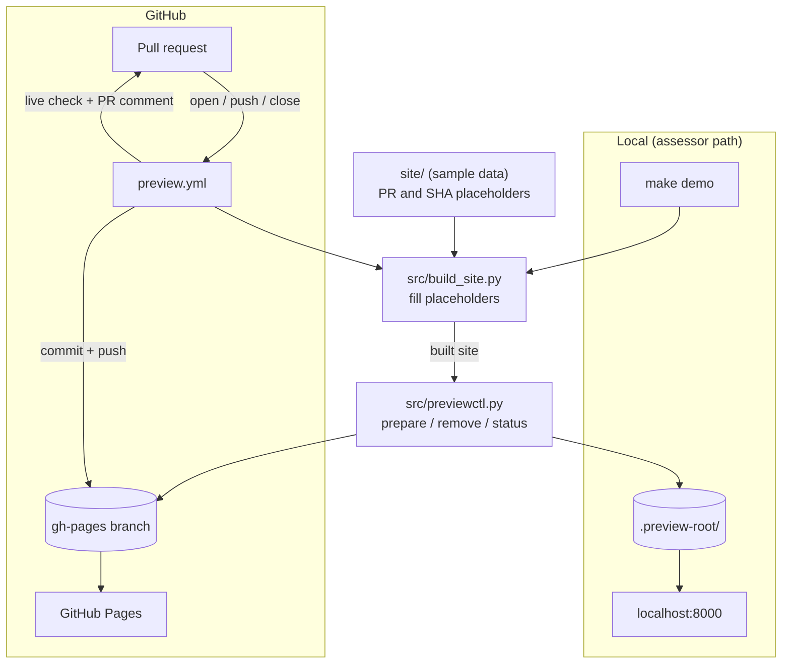

# Design

## Architecture



The same two Python tools write to `.preview-root/` locally and to a `gh-pages` checkout in CI. Locally a web server serves the folder; in CI a git push publishes it.

## Component boundaries

| Component | Owns | Never does |
|---|---|---|
| `site/` | Sample page that shows `{{PR}}` and `{{SHA}}`; relative links only | – |
| `src/build_site.py` | Copies `site/` and fills in the placeholders; refuses an output folder that isn't empty | Publish anything |
| `src/previewctl.py` | Validates input, then adds, replaces or removes **one** `pr-preview/pr-<N>/` folder and its manifest entry; `status` | Run git or `gh`, use the network, touch anything outside `pr-preview/` |
| `ci.yml` | `make setup verify` with a read-only token | Write anything |
| `preview.yml` | Checkouts, build, `previewctl`, commit and push, live check, PR comment | File logic (delegated to `previewctl`) |

## Data flow

```
site/ ──build_site──▶ dist/ ──previewctl prepare──▶ <root>/pr-preview/pr-<N>/
                                                   <root>/pr-preview/previews.json
<root> = .preview-root/ (local)  or  gh-pages checkout (CI) ──git push──▶ GitHub Pages
```

The manifest has one entry per PR: `{"<N>": {"sha": "...", "updated_at": "..."}}`.

## Key trade-offs

1. **Python does the files, YAML does git and GitHub.** All file logic is testable locally with no network, and Python never holds a token.
2. **Check first, then write.** Each of these exits with code 1 before anything is written:
   - a bad PR number or SHA;
   - a missing `index.html`;
   - a symlink in the source;
   - a path outside `pr-preview/`.

   Unexpected errors exit with code 2.
3. **Swap instead of overwrite.** `prepare` copies into a staging folder and swaps it in, and restores the old preview if the swap fails. The manifest is replaced atomically.
4. **Branch-based Pages, not artifact deploys.** An artifact deploy replaces the whole site, which would wipe other PRs' previews.
5. **One publisher at a time.** All runs share the `gh-pages` concurrency group with `queue: max`, so up to 100 waiting runs are kept instead of the newest replacing the one waiting.

## Security & privacy

- **Forks are excluded.** Fork PRs are skipped by an `if:` condition, so fork code never runs with a write token.
- **Minimal permissions.** `preview.yml` has only `contents: write` and `pull-requests: write`; `ci.yml` has `contents: read`.
- **Credentials arrive late.** The PR checkout doesn't keep credentials, so `make verify` and the build run before any push credentials are on disk. Only the later `gh-pages` checkout can push.
- **Nothing extra is published.** Symlinks in the source are rejected, so no file from outside the build reaches the public site.
- **Public by design.** The site holds sample data only; no secrets or environment variables are rendered into it.
- **Known gap.** PR code still runs in the job that holds the write token. In particular, `previewctl.py` from the PR runs after the `gh-pages` credentials are on disk. This is acceptable only because same-repo authors already have push access.

## Technology choices

| Choice | Why |
|---|---|
| Python 3.12+, standard library only | No runtime dependencies to install or audit |
| pytest + ruff, pinned | Fast checks; pinned versions keep CI reproducible |
| GNU Make | One entry point (`make verify`) for humans and CI |
| GitHub Actions + Pages | No extra infrastructure or credentials |
| Codex code review | Automatic PR review against `AGENTS.md` |

## Production / cloud shape

- **Split build and publish.**
  - A `build` job with `contents: read` tests and builds the PR, then uploads `dist/` as an artifact.
  - A `publish` job takes `previewctl.py` from `main` (trusted code), downloads the artifact, validates it as untrusted data, then publishes.
  - This closes the known gap. A `workflow_run` trigger on `main` is needed for full isolation, because a `pull_request` workflow file comes from the PR.
- **Private previews.** Object storage under a `pr-<N>/` prefix behind a CDN with SSO. The validate-then-swap logic carries over.
- **Short-lived credentials.** OIDC federation to the cloud, with no long-lived secrets.
- **Stale cleanup.** A scheduled job compares the manifest with open PRs.
- **Promotion.** `main` → staging → production through one pipeline, with an approval gate before production.
